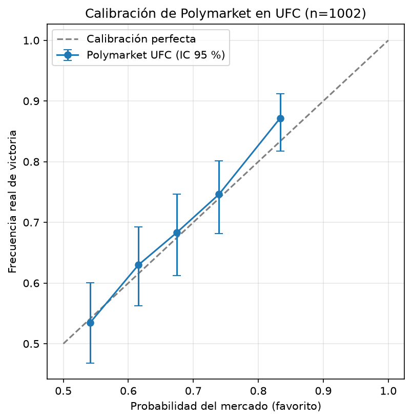

# Polymarket UFC: ¿qué tan bien calibrado está el mercado?

Análisis en Python de la calibración de las probabilidades de Polymarket en peleas de UFC.

**Pregunta:** cuando el mercado asigna 70 % de probabilidad a un favorito, ¿gana realmente alrededor del 70 % de las veces?

## Resultado principal

- **Muestra:** 1.002 peleas de UFC con mercado cerrado en Polymarket ([2024--4-13] a [2026-10-18]).
- **Favoritos que ganaron:** 69,0 %, frente a una probabilidad media asignada de 67,8 %.
- **Brier score del mercado:** 0,2016 (IC 95 %: 0,191 a 0,213), frente a 0,25 de predecir siempre 50 %.
- **Referencia más exigente:** predecir siempre la tasa base del favorito da un Brier de [X], así que el mercado la supera de forma modesta.
- **Conclusión:** los cinco grupos de probabilidad quedan dentro del intervalo de confianza de la frecuencia real. No hay evidencia estadística de descalibración. En el grupo de grandes favoritos (~83 %) se observa una tendencia leve a que ganen más de lo esperado (87 %), pero no es estadísticamente distinguible del azar.

| Grupo | Peleas | Mercado dice | Real | IC 95 % (real) |
|---|---|---|---|---|
| 1 | 215 | 54,1 % | 53,5 % | 46,8 % a 60,0 % |
| 2 | 208 | 61,6 % | 63,0 % | 56,2 % a 69,3 % |
| 3 | 183 | 67,4 % | 68,3 % | 61,2 % a 74,6 % |
| 4 | 201 | 74,0 % | 74,6 % | 68,2 % a 80,1 % |
| 5 | 195 | 83,4 % | 87,2 % | 81,8 % a 91,2 % |

## Método

1. **Datos:** se descargan eventos cerrados de UFC desde la API pública Gamma de Polymarket.
2. **Filtrado:** se conservan solo mercados de pelea resueltos con claridad (dos peleadores, un lado cerca de 1 y el otro cerca de 0).
3. **Probabilidad previa:** se toma el último precio disponible 24 horas antes del cierre del mercado, usando el historial de la API CLOB.
4. **Un lado por pelea:** se analiza al favorito, para no contar dos veces la misma pelea.
5. **Métricas:** Brier score con intervalo de confianza por bootstrap (2.000 repeticiones) y curva de calibración con intervalos de Wilson.

## Limitaciones

- La probabilidad se mide 24 h antes de la **fecha de cierre del mercado**, no de la hora exacta de la pelea.
- Solo entraron peleas con historial de precios (1.003 de 1.155, 86,8 %).
- Las peleas de un mismo evento no son totalmente independientes.
- Mercados con poca liquidez pueden tener precios menos informativos.
- Una sola ventana temporal (24 h); no se evaluó cómo cambia la calibración al acercarse la pelea.

## Cómo reproducirlo

    git clone https://github.com/ArmijosKarla/polymarket-ufc.git
    cd polymarket-ufc
    python -m venv .venv
    .venv\Scripts\activate
    pip install -r requirements.txt
    python src/descargar.py
    python src/construir_dataset.py
    python src/analisis.py

## Estructura

- `src/descargar.py`: descarga y filtra mercados de UFC.
- `src/construir_dataset.py`: obtiene la probabilidad previa a la pelea.
- `src/analisis.py`: Brier score, calibración y gráfico.
- `data/`: datasets en CSV.
- `figuras/`: gráficos generados.

## Referencias

- Brier, G. W. (1950). Verification of forecasts expressed in terms of probability. *Monthly Weather Review*.
- Gneiting, T. y Raftery, A. E. (2007). Strictly Proper Scoring Rules, Prediction, and Estimation. *Journal of the American Statistical Association*.
- Snowberg, E. y Wolfers, J. (2010). Explaining the Favorite-Long Shot Bias. *Journal of Political Economy*.
- Wilson, E. B. (1927). Probable inference, the law of succession, and statistical inference. *Journal of the American Statistical Association*.